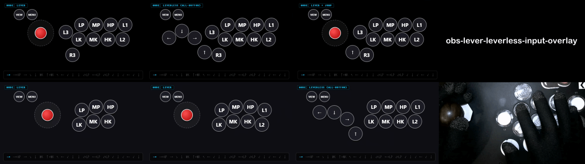

# obs-lever-leverless-input-overlay

---

<details>
<summary><sub>管理用メモ（リリース作成手順）</sub></summary>

> <sub>GitHubの「Releases」→「Draft a new release」から新しいタグ（`v1.0.0` 等）を作成して「Publish release」を実行すると、GitHub Actions（`.github/workflows/release.yml`）によってHTMLファイル3種が自動で添付されます（手動でのファイル添付は不要）。</sub>
</details>

---

OBS Studioのブラウザソースや一般的なWebブラウザ上で動作する、格闘ゲーム（ストリートファイター6など）向けのコントローラー入力可視化オーバーレイです。

外部ライブラリや画像アセットに依存しない**単一HTMLファイル（`InputOverlay.html`）完結型**で、ファイル先頭のCSS変数の書き換え、または**OBSのブラウザソースの「カスタムCSS」欄からの設定上書き**によって、**レバー（アケコン）** / **レバー＋親指ジャンプボタン** / **レバーレス（オールボタン）** の切り替えや、ボタン配置・ラベル・配色のカスタマイズが可能です。



---

## 主な特徴

- **単一ファイル完結**: `InputOverlay.html` 1ファイルのみで動作し、サーバー不要でローカルファイルとしてそのまま読み込めます。
- **3つのコントローラー構成に対応**:
  - **LEVER**: アケコン（レバー＋攻撃ボタン）
  - **LEVER + JUMP**: レバー＋親指ジャンプ（↑）ボタン併用構成
  - **LEVERLESS (ALL-BUTTON)**: レバーレス（移動ボタン `←` `↓` `→` `↑`＋攻撃ボタン）
- **リアルタイム入力履歴ログ**: 画面下部に方向入力と同時押し（`↘+HP` など）の履歴を最大25件まで表示（非表示にも切り替え可能）。
- **柔軟なカスタマイズ（OBSカスタムCSS対応）**:
  - HTMLファイル内の設定変更だけでなく、OBS側の「カスタムCSS」欄に設定を貼り付けるだけでもレイアウトやモードを切り替え可能
  - 各ボタンの表示ラベル変更（文字数に応じたフォントサイズ自動調整機能付き）
  - 各ボタンの表示/非表示（`flex` / `none`）およびピクセル単位の配置座標調整
  - 全体のテーマカラー変更、およびボタン個別の通常色・押下時カラーの割り当て

---

## 使い方

### OBS Studio で使用する場合
1. OBSの「ソース」から **「ブラウザ」** を追加します。
2. プロパティで以下の通り設定します：
   - **ローカルファイル**: チェックを入れ、`InputOverlay.html` を指定
   - **幅**: `640`
   - **高さ**: `360`
   - ※画面上で大きく（または小さく）表示したい場合も、プロパティの解像度（`640`×`360`）はそのままで、OBSのプレビュー画面上でソースの枠を拡大・縮小（スケーリング）して調整することを推奨します（解像度側を変更すると余白や見切れの原因になります）。
3. コントローラーのボタンを何か1回押すと、Gamepad APIが入力を検知してオーバーレイに反映されます。
4. `InputOverlay.html` の設定を変更・保存した後は、OBSのブラウザソースのプロパティ下部にある **「現在のページのキャッシュを更新」** をクリックして反映してください。

### 通常のWebブラウザで確認・調整する場合
1. Chrome や Edge などのブラウザで `InputOverlay.html` を開きます。
2. コントローラーのボタンを何か1回押すと入力が反映されます。
3. エディタで `InputOverlay.html` を編集・保存し、`F5` キーでページを再読み込みして表示を確認します。

---

## カスタマイズ方法

`InputOverlay.html` 先頭の `<style>` 内にある `:root`（**全設定集中管理エリア**）のCSS変数を編集することでカスタマイズできます。

### 1. モード切替・移動入力（レバー / 移動ボタン）表示設定

| 設定パターン | `--lever-display` | `--mvmt-display` | `--jump-display` | モード表示 (`#mode-display`) | 設定済みサンプル |
| :--- | :---: | :---: | :---: | :--- | :--- |
| **レバー（標準）** | `flex` | `none` | `none` | `MODE: LEVER` | `InputOverlay.html` |
| **レバー＋ジャンプボタン** | `flex` | `none` | `flex` | `MODE: LEVER + JUMP` | `mode_samples/InputOverlay_LeverPlusJumpButton.html` |
| **レバーレス** | `none` | `flex` | `flex` | `MODE: LEVERLESS (ALL-BUTTON)` | `mode_samples/InputOverlay_Leverless.html` |

- `--mode-display` を `none` にすると、左上のモード表示バッジ（`MODE: LEVER` など）を非表示にできます。
- `--log-display` を `none` にすると、下部の入力履歴ログを非表示にできます。
- `mode_samples/` ディレクトリ内に、あらかじめ「レバー＋ジャンプボタン」「レバーレス」に設定済みのサンプルファイルを用意しています。そのままOBSに読み込ませて使用することも可能です。

### 2. ボタン表示名設定

各ボタンのラベルは `--label-btn-XX` で設定します（3〜4文字、5文字以上で自動的にフォントサイズが縮小されます）。
※ボタン表示名の初期値については、ある程度の汎用的なゲーム対応と呼称されることの多い名称に合わせるようにしています。そのため、各種ゲームやプラットフォームが入り混じったような表記になっています。

| CSS変数 | ボタン番号 | PC | PS | デフォルト値 | 用途・備考例 |
| :--- | :---: | :---: | :---: | :---: | :--- |
| `--label-btn-14` | Btn 14 | D-Pad Left | 十字キー左 | `"←"` | 移動ボタン左 |
| `--label-btn-13` | Btn 13 | D-Pad Down | 十字キー下 | `"↓"` | 移動ボタン下 |
| `--label-btn-15` | Btn 15 | D-Pad Right | 十字キー右 | `"→"` | 移動ボタン右 |
| `--label-jump` | Btn 12 | D-Pad Up | 十字キー上 | `"↑"` | 移動ボタン上（親指ジャンプ） |
| `--label-btn-02` | Btn 02 | X | □ (Square) | `"LP"` | 弱P |
| `--label-btn-03` | Btn 03 | Y | △ (Triangle) | `"MP"` | 中P |
| `--label-btn-05` | Btn 05 | RB | R1 | `"HP"` | 強P |
| `--label-btn-04` | Btn 04 | LB | L1 | `"L1"` | 上段4ボタン目（パリィ / インパクト等） |
| `--label-btn-00` | Btn 00 | A | × (Cross) | `"LK"` | 弱K |
| `--label-btn-01` | Btn 01 | B | ○ (Circle) | `"MK"` | 中K |
| `--label-btn-07` | Btn 07 | RT | R2 | `"HK"` | 強K |
| `--label-btn-06` | Btn 06 | LT | L2 | `"L2"` | 下段4ボタン目（`"DI"` 等に変更可） |
| `--label-btn-10` | Btn 10 | LS | L3 | `"L3"` | サブボタン1 |
| `--label-btn-11` | Btn 11 | RS | R3 | `"R3"` | サブボタン2（`"DP"` 等に変更可） |
| `--label-btn-08` | Btn 08 | View | Share / Create / TouchPad | `"VIEW"` | システムボタン1（※PS5接続時はタッチパッド割当の場合あり） |
| `--label-btn-09` | Btn 09 | Menu | Options | `"MENU"` | システムボタン2 |

### 3. 各要素の配置座標・サイズ設定

- **サイズ変更**:
  - `--size-btn-main`: 標準ボタン（攻撃・サブボタン）の直径
  - `--size-btn-sys`: システムボタン（Btn 08: VIEW / Btn 09: MENU）の直径
  - `--size-btn-jump`: 親指ジャンプボタン（Btn 12: `↑`）の直径
- **ボタンの表示 / 非表示切り替え**:
  - **攻撃・サブ・システムボタン（Btn 00〜11）**: 使用しないボタンを `--disp-btn-XX: none;` に設定することで個別に非表示にできます。
  - **移動ボタン（Btn 14: `←` / Btn 13: `↓` / Btn 15: `→`）**: `--mvmt-display: none;` で一括非表示にできます。
  - **親指ジャンプボタン（Btn 12: `↑`）**: `--jump-display: none;` で非表示にできます（※移動・ジャンプボタンは個別の `--disp-btn-XX` ではなく専用変数で制御します）。
- **配置座標の調整**:
  - **各ボタン**: `--pos-btn-XX-top` / `--pos-btn-XX-left` でボタン位置をピクセル単位で調整できます。
  - **親指ジャンプボタン（Btn 12: `↑`）**: 専用の `--pos-jump-top` / `--pos-jump-left` で調整します。
  - **レバー本体**: `--pos-lever-top` / `--pos-lever-left` で調整します。

### 4. デザイン・カラーカスタマイズ設定 【中級者用】

- `--bg-color`（全体背景色）、`--lever-*`（レバー土台・玉の配色）、`--btn-*`（通常時・押下時のボタン配色・発光エフェクト）、`--log-*`（入力ログエリアの配色）で全体のトーンを変更できます。

### 5. 個別ボタン・カラーカスタマイズ設定 【上級者用】

- `--btn-individual-color-enable: 1;` に設定すると、ボタンごとに `--btn-XX-bg`（通常時背景色）と `--btn-XX-act`（押下時背景色）の個別カラー設定が有効になります。

### 6. 対象コントローラー（1P/2P等）指定設定 【上級者用】

- デフォルト（`--gamepad-index: auto;`）では、PCに接続されている**すべてのコントローラーの入力**を受け取ります（複数デバイスを接続している場合でも設定不要でそのまま反応します）。
- 1P用・2P用で別々のオーバーレイを表示したい場合など、特定のコントローラーのみの入力を受け取りたい場合は、`--gamepad-index` にコントローラー番号（`0`, `1`, `2`, `3` 等）を指定してください（指定時は左上のモード表示に `(ID: 0)` のように対象IDが表示されます）。

---

## OBSでの高度な使い方（カスタムCSSによる設定上書き）

`InputOverlay.html` 本体を直接書き換えなくても、OBSのブラウザソースのプロパティにある **「カスタムCSS」** 欄に `:root { ... }` を追記することで、モード切替・ボタン配置・ラベル・配色・対象コントローラーIDなどの全設定をOBS側から上書きできます。

1つの `InputOverlay.html` を複数のシーンやソースで共有しながら、OBS側の設定だけでレイアウトや対象コントローラーを切り替えたい場合に便利です。

### カスタムCSSサンプル (`custom_css_samples/`)

`custom_css_samples/` ディレクトリ内に、OBSの「カスタムCSS」欄へそのままコピー＆ペーストして使えるレイアウト・モード別のサンプルCSSを用意しています：

| サンプルファイル | 内容・レイアウト構成 |
| :--- | :--- |
| `InputOverlay_Lever.css` | **レバー（標準）構成**：8ボタン＋サブボタン（L3/R3） |
| `InputOverlay_Lever_8Button.css` | **レバー 8ボタンアケコン構成**：8ボタン表示（L3/R3非表示）＋両端（弱P/弱K・L1/L2）を一段下げたアーチ型配置 |
| `InputOverlay_Lever_6Button.css` | **レバー 6ボタンアケコン構成**：弱P・中P・強P / 弱K・中K・強K の6ボタンのみ表示＋弱P/弱Kを一段下げた配置＋レバー位置を少し右寄せ |
| `InputOverlay_LeverPlusJumpButton.css` | **レバー＋親指ジャンプボタン構成**：レバー表示＋親指ジャンプ（↑）ボタン併用 |
| `InputOverlay_Leverless.css` | **レバーレス（標準）構成**：移動4＋攻撃8＋増設サブボタン（L3/R3）の14ボタン配置 |
| `InputOverlay_Leverless_Legacy.css` | **レガシーレバーレス（12ボタン）構成**：増設サブボタン（L3/R3）を非表示にし、`←` `↓` `→` `↑` の位置を調整した配置 |

---

## ファイル構成

```text
.
├── InputOverlay.html       # オーバーレイ本体（標準：レバー構成）
├── mode_samples/           # モード変更済みHTMLサンプル
│   ├── InputOverlay_LeverPlusJumpButton.html  # レバー＋ジャンプボタン構成
│   └── InputOverlay_Leverless.html            # レバーレス構成
├── custom_css_samples/     # OBS「カスタムCSS」貼り付け用サンプル
│   ├── InputOverlay_Lever.css                 # レバー（標準）構成
│   ├── InputOverlay_Lever_8Button.css         # レバー 8ボタンアケコン構成
│   ├── InputOverlay_Lever_6Button.css         # レバー 6ボタンアケコン構成
│   ├── InputOverlay_LeverPlusJumpButton.css   # レバー＋ジャンプボタン構成
│   ├── InputOverlay_Leverless.css             # レバーレス（標準）構成
│   └── InputOverlay_Leverless_Legacy.css      # レガシーレバーレス（12ボタン）構成
├── README.md               # ドキュメント
├── LICENSE                 # ライセンス定義（0BSD）
└── .gitignore              # Git除外設定
```

---

## ゲームパッド（パッド型コントローラー）の表示対応について

<details>
<summary>パッド型の見た目・レイアウトに標準対応していない理由（クリックで展開）</summary>

本ツールはゲームパッドからの入力自体には対応していますが、パッド型の見た目・レイアウト表示については以下の理由から標準対応を見送っています。

- **形状再現の難しさ**: ゲームパッドは曲線的・有機的なフォルムが多く、十字キー・アナログスティック・上部のL/Rボタンや背面ボタンといった立体的な配置を、本ツールのようなシンプルな図形（円と枠）の組み合わせだけで表現するのは難しいため。
- **意匠・権利面のリスク**: ゲームパッドは製品ごとにアイコニックな形状やデザインが多く、見た目を似せようとすると意図せず意匠等の再現によるトラブルが生じる可能性があるため（この点、いわゆるアーケードコントローラー種についてはレバーや主要操作ボタンの配置再現であれば低リスクであると判断しています）。
- **改変・派生作成は自由（0BSD）**: 本プロジェクトは **0BSD** ライセンスで公開しているため、用途・目的を問わず、本ツールのコードをベースにして独自にパッド型オーバーレイ等を改変・作成・公開すること自体は、連絡やクレジット表記も含め不要であり、作成者の責任において自由に行うことができます。

※なお、コントローラーのメーカーやブランドによっては、公式で専用の入力表示オーバーレイツール/アプリを公開しているところもあります。
</details>

---

## ライセンス

本プロジェクトは **0BSD (BSD Zero Clause License)** の下で公開されています。
著作権表示やライセンス文の保持義務を含め、条件なし（無保証）で自由に使用・複製・改変・再配布が可能です。詳細は [LICENSE](LICENSE) を参照してください。
